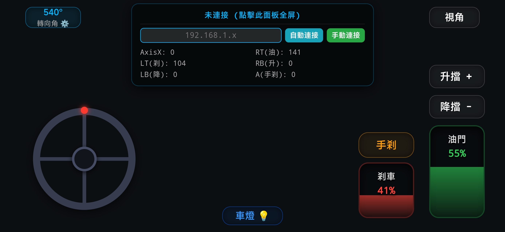
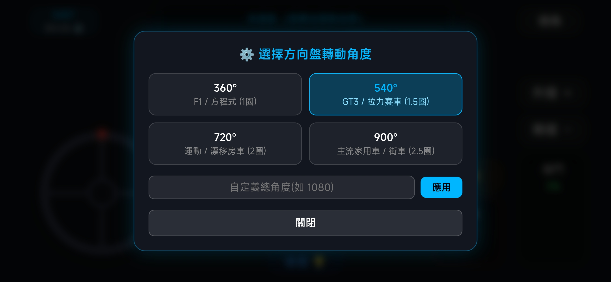

# AC Jetta Remake

[English](README.md) | [繁體中文](README_zh-Hant.md) | 简体中文

灵感来自于经典手游CPM（Car Parking Multiplayer）


把你的手机变成 Assetto Corsa 的无线方向盘和踏板。

手机上显示触控方向盘、油门、刹车和按键，所有触控输入经局域网传到电脑上的小型 Python 服务器，再经虚拟 Xbox 360 手柄注入 Windows，游戏看到的就是一个真的手柄，不需要装游戏模组。

```
手机（触控界面）-- WebSocket，局域网 :9999 --> 电脑服务器（Python）
    --> vgamepad / ViGEmBus --> 虚拟 Xbox 360 手柄 --> Assetto Corsa
```

2026 年夏天、大学开学之前做的。代码在 AI 协助下写成（Gemini 免费版）；我负责定功能、测试和调试，前后迭代了五天，Android App 是我自己在 Android Studio 打包的。

## 功能

- **模拟方向盘** — 拖动屏幕上的方向盘，角度会累积计算（atan2 增量，附 ±180° 跨界修正），最大 900°（1.25 圈），松手后会自动回正。
- **模拟踏板** — 油门和刹车分别对应右、左扳机。
- **按键** — Start、RB / LB（升档／降档）、A 和 Y，对应 Xbox 手柄的相同按键。在 Assetto Corsa 的控制设置里绑定（例如 A 当手刹）。
- **断线安全锁** — 手机一断线，服务器会即时把摇杆、扳机和所有按键归零，车子不会卡着油门一直冲。
- **自动连接** — 客户端可以扫描局域网找服务器，也可以手动输入电脑 IP。但自动连接还有些未知问题，有时会连不上。
- **极简协议** — 每帧一个逗号分隔的字符串，例如 `X:12345,T:180,B:0,BK:0,ST:0,RB:0,LB:0,A:0,Y:0`。没有 JSON，热路径上不打 log，脏包直接静默丢掉。

## 文件结构

```
server/server.py   电脑端：WebSocket 服务器（端口 9999）+ vgamepad 注入（V23.2）
client/index.html  手机端：整个触控界面，纯 HTML/CSS/JS（V25.0）
                   Android APK 是这个页面的 WebView 包装（见 Releases）。
requirements.txt   Python 依赖
```

## 需求

- Windows 10/11 电脑（虚拟手柄需要 ViGEmBus 驱动，只有 Windows 有），并已安装 Python 3。
- Android 手机，或任何手机浏览器，跟电脑在同一个局域网／热点。
- 电脑上有 Assetto Corsa。
- Assetto Corsa 的 Content Manager。

## 电脑端设置

1. 去 python.org 安装 Python 3。安装程序第一个画面要勾 **Add Python to PATH**，不然终端会找不到 `python` 命令。
2. 去 [Releases](../../releases) 下载 server.py，放到一个你容易找到的文件夹。
3. 在那个文件夹里打开终端：

   ```powershell
   pip install vgamepad websockets
   ```

   安装 `vgamepad` 时会自动弹出 **ViGEmBus 驱动**安装程序：接受授权、按 Install（需要管理员权限）、再按 Finish。这个驱动就是让 Windows 以为真的插了一个 Xbox 360 手柄的东西，没有它，`vgamepad` 就建不出手柄。
4. 启动服务器：

   ```powershell
   python (server 文件的位置)\server.py
   ```

   它会印出你电脑的局域网 IP。这个窗口不要关。
5. 检查虚拟手柄是不是真的存在：按 Win+R，输入 `joy.cpl`，按 Enter。应该会看到 "Controller (Xbox 360 Controller for Windows)"。选它、开 Properties，动一下手机方向盘和踏板，轴应该要有反应。如果没有手柄出现，就是 ViGEmBus 驱动没装好（见下面）。
6. 先开 Assetto Corsa 的 Content Manager，**之后**再启动服务器，这样游戏启动时才看得到手柄。如果先开服务器，有时还会跟游戏连接出问题。失败的话多试几次。

如果遇到问题：

- 手机连不上：确认手机和电脑在同一个网络（同一个 Wi-Fi，或手机热点、电脑连上去）。在 Windows 防火墙放行 Python，或开放 TCP 端口 9999。
- 出现 `OSError: ViGEmBus is not installed`：去 [ViGEmBus releases](https://github.com/nefarius/ViGEmBus/releases) 手动安装驱动并重启，再启动服务器。
- Assetto Corsa 没反应：关掉游戏的 Steam Input（Steam 游戏库 → 右键 Assetto Corsa → Properties → Controller → Disable Steam Input）。Steam 会在游戏之前拦截 XInput 手柄。

7. 设置做完一次之后，就不用重做第 1、2、3 步了。之后只要找到 server.py、启动它、看 IP、输入到手机就能连上。用手柄的时候不要关掉 server.py 那个黑窗口。

## 手机端设置

**方法 A — APK（最简单）：**去 [Releases](../../releases) 下载 APK、安装、打开，输入电脑的局域网 IP（自动连接在某些设备上用不了，可以试试），就可以开车了。

**方法 B — 浏览器：**在手机浏览器打开 `client/index.html`（跟电脑同一个网络），输入电脑的局域网 IP，就可以开车了，不用安装。但要先将屏幕转为横屏。[Releases](../../releases) ← 这里也可以下载 `client/index.html`。

注意：自动连接只会扫 `192.168.1.1–254`。如果你的网络是别的网段（例如手机热点的 `192.168.43.x`），就手动输入服务器印出的 IP。建议直接手动输入 IP，忽略自动连接功能，因为它大多数时候都不太灵。

## 在 Assetto Corsa 里绑定控制

服务器开着、手机连上的状态下，打开 Assetto Corsa，去 Settings → Controls（Content Manager 是 Settings → Assetto Corsa → Controls）。确认选中的设备是 Xbox 360 手柄。然后点每一个动作，再动对应的手机控制：

| AC 里的动作 | 手机控制 | 虚拟输入 |
|---|---|---|
| Steer Left / Right（转向） | 拖方向盘 | 左摇杆 X 轴 |
| Gas（油门） | 油门滑杆 | 右扳机 |
| Brake（刹车） | 刹车滑杆 | 左扳机 |
| Shift Up（升档） | RB 按键 | RB |
| Shift Down（降档） | LB 按键 | LB |
| Handbrake（手刹） | A 按键 | A |
| （自选） | Y / Start 按键 | Y / Start |

如果转向方向反了，就勾 Invert（反转）。绑完存一个 preset，下次就不用重做。如果高速时觉得车子太敏感，就调低 Steering Speed 或调高 Speed Sensitivity；如果觉得转向太迟钝，就反过来。凭感觉调——可调的是 Steering Speed、Steering Gamma、Filter 和 Speed Sensitivity。

## 已知限制

- V23.2 的服务器是**单向**的：只接收输入。
- `BK`（Back 按键）永远是 0——界面上没有 Back 按键。服务器解析没问题，只是它永远不会变成 1。
- 只支持 Windows，因为驱动的原因。
- 在低性能的电脑上表现不好。
- 散热不好的情况下会让手机过热。

## 授权

MIT — 见 [LICENSE](LICENSE)。
